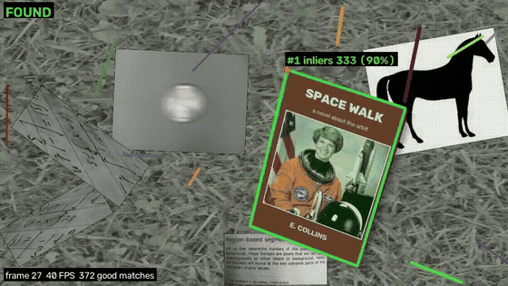
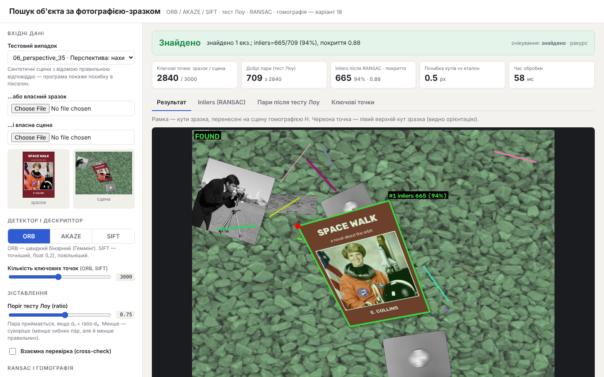
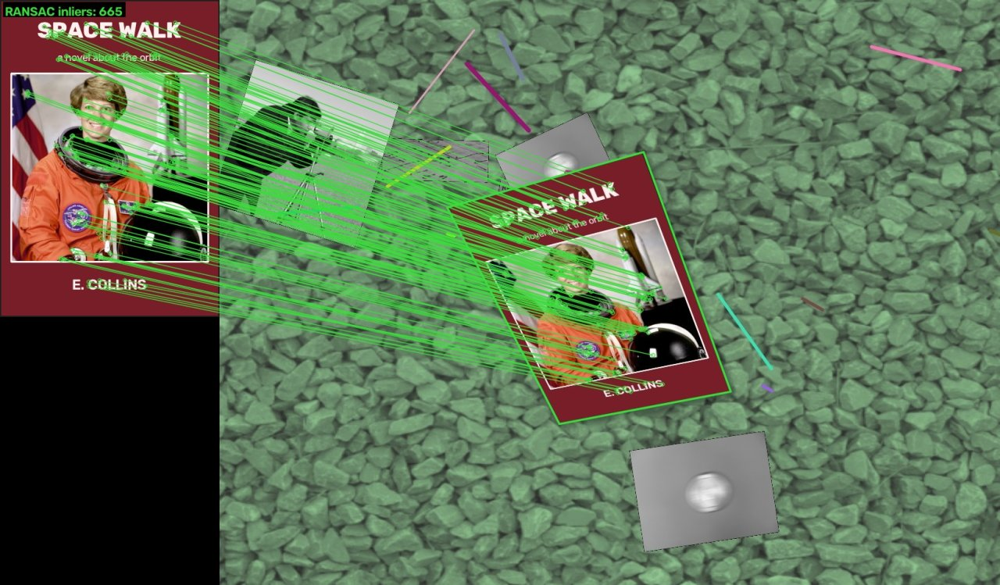
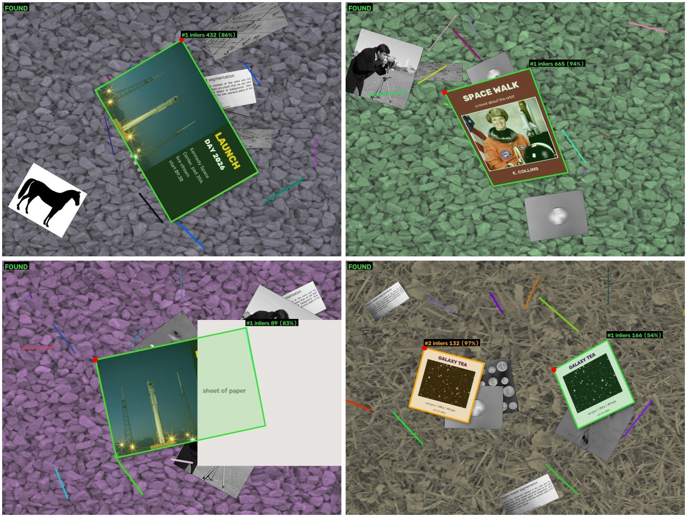
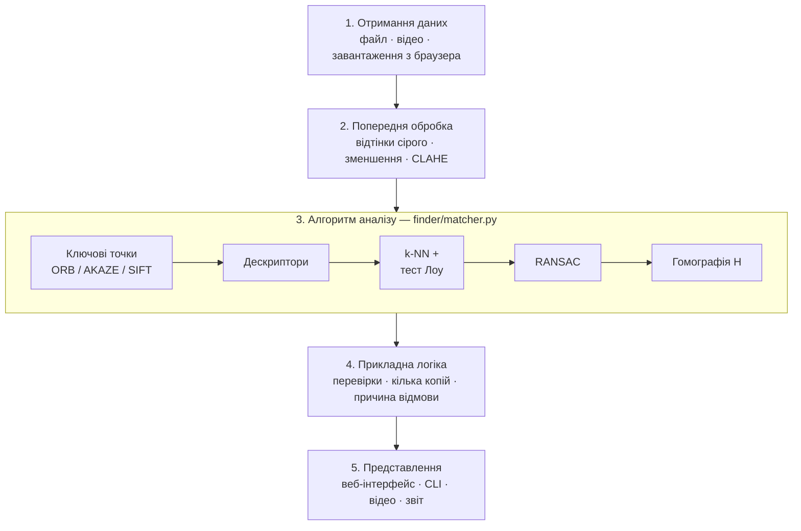
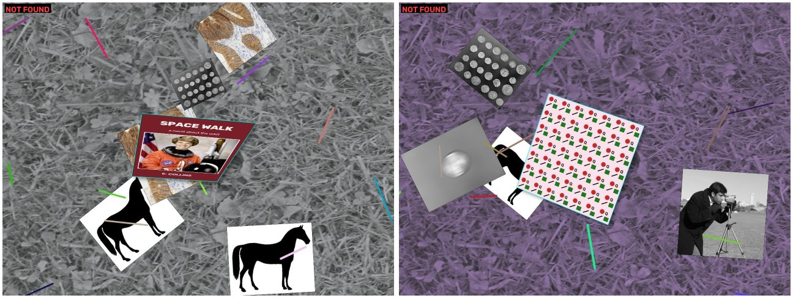

# Пошук об'єкта за фотографією-зразком

**Індивідуальний проєкт з дисципліни «Комп'ютерний зір» · Варіант 18**
**Виконав: Водяний Олександр**

За фото обкладинки книги, плаката або упаковки програма знаходить цей об'єкт на іншому зображенні
і обводить область збігу. Пошук працює при зміні масштабу, повороті, зміні ракурсу, частковому
перекритті й поганому освітленні.

**Методи:** ORB (а також AKAZE і SIFT для порівняння), зіставлення дескрипторів (k-NN + тест Лоу), RANSAC, гомографія.
**Технології:** Python 3, OpenCV, NumPy, локальний веб-інтерфейс (стандартна бібліотека Python + HTML/JS).

<p align="center"></p>

---

## Зміст

1. [Постановка задачі](#1-постановка-задачі)
2. [Запуск](#2-запуск)
3. [Демонстрація](#3-демонстрація)
4. [Архітектура](#4-архітектура)
5. [Алгоритм](#5-алгоритм)
6. [Параметри](#6-параметри)
7. [Тестування і результати](#7-тестування-і-результати)
8. [Типові помилки та обмеження](#8-типові-помилки-та-обмеження)
9. [Структура репозиторію](#9-структура-репозиторію)
10. [Висновки](#10-висновки)

---

## 1. Постановка задачі

| Вимога варіанта | Як реалізовано |
|---|---|
| Знайти об'єкт за фото-зразком | Ключові точки ORB на зразку і сцені, зіставлення дескрипторів |
| Стійкість до масштабу, повороту, ракурсу | Піраміда масштабів і орієнтація точок у ORB, модель гомографії |
| Стійкість до хибних збігів | Тест Лоу, RANSAC, перевірки геометрії та покриття |
| Позначити область збігу | Кути зразка переносяться на сцену матрицею гомографії H |
| Без фізичного обладнання | Тестові зображення і відео генеруються програмно з відомою правильною відповіддю |

**Вхід:** зображення-зразок і зображення-сцена. **Вихід:** «знайдено / не знайдено» з поясненням,
4 кути об'єкта на сцені, матриця гомографії 3×3, кількість inliers, час етапів.

## 2. Запуск

Потрібен Python 3.8+.

```bash
pip install -r requirements.txt     # opencv-contrib-python + numpy
python web_app.py                   # веб-інтерфейс → http://127.0.0.1:8018
```

У Windows після встановлення залежностей можна просто двічі клацнути `run_web.bat`.

| Режим | Команда |
|---|---|
| Одне зображення | `python find_object.py data/templates/book_astronaut.png data/scenes/06_perspective_35.jpg --show` |
| Кілька копій | `python find_object.py data/templates/pack_tea.png data/scenes/09_two_copies.jpg --instances 2` |
| Інший детектор | `python find_object.py <зразок> <сцена> --detector SIFT --ratio 0.85 --min-inliers 8` |
| Відео | `python find_in_video.py data/templates/book_astronaut.png data/video/demo_input.mp4 --show` |
| Повне тестування | `python evaluate.py` (≈ 2 хв, звіт → `results/evaluation.md`) |
| Модульні тести | `python -m unittest discover tests -v` |

## 3. Демонстрація

**Веб-інтерфейс.** Можна вибрати тестовий випадок або завантажити власні фото й змінювати параметри повзунками:
результат перераховується одразу. Вкладки показують кожен етап: ключові точки → пари після тесту Лоу →
inliers після RANSAC → рамка.



**Зіставлення після RANSAC.** Зелені лінії з'єднують точки зразка з відповідними точками сцени
(665 inliers, нахил 35°):



**Результати на складних сценах:** поворот 60°, нахил 35°, перекриття 40%, дві копії на одній сцені.



Відеозапис роботи інтерфейсу: [`docs/demo_ui.mp4`](docs/demo_ui.mp4). Оброблене відео: [`results/video_result.mp4`](results/video_result.mp4).

## 4. Архітектура



| Компонент | Де в коді | Що робить |
|---|---|---|
| Отримання даних | `load_image()`, `cv2.VideoCapture`, `web_app.py` | Читає зображення з диска, відео або з браузера (base64) |
| Попередня обробка | `preprocess()`, `_resize_max_side()` | Сірий, зменшення до 1280 / 640 px, опційно CLAHE |
| Алгоритм аналізу | `ObjectFinder.set_template()`, `_match()`, `find()` | Ключові точки, дескриптори, зіставлення, RANSAC |
| Прикладна логіка | `check_homography()`, `inlier_coverage()` | Рішення «знайдено / ні», пошук кількох копій |
| Представлення | `visualize.py`, `web/index.html`, `evaluate.py` | Рамка, лінії відповідностей, метрики, звіт |

Дескриптори зразка рахуються **один раз**. На відео для кожного кадру виконуються лише детекція,
зіставлення і RANSAC (≈ 30 мс на кадр, ≈ 34 кадри/с для ORB).

## 5. Алгоритм

1. **Попередня обробка.** Переведення в відтінки сірого, зменшення розміру, CLAHE для темних фото.
2. **Ключові точки ORB.** FAST шукає кути (≥ 9 з 16 пікселів на колі навколо значно світліші чи темніші),
   найкращі 3000 відбираються за відгуком Гарріса. Піраміда з 8 масштабів (крок 1.2) дає стійкість до розміру,
   а орієнтація за центроїдом яскравості — до повороту.
3. **Дескриптори rBRIEF.** 256 порівнянь яскравості пар пікселів у поверненому патчі 31×31 дають 256-бітний рядок.
   Порівнюються **відстанню Геммінга** (кількість різних бітів).
4. **Зіставлення.** Для кожного дескриптора шукаються 2 найближчі (k-NN). Пара приймається, якщо
   d₁ < 0.75 · d₂ (**тест Лоу**): найкращий збіг має бути помітно кращим за другий.
5. **Гомографія.** Матриця H 3×3 (8 ступенів свободи) переносить точки плоского об'єкта зі зразка на сцену
   з урахуванням перспективи. Для обчислення потрібно ≥ 4 пари точок.
6. **RANSAC.** Багаторазово бере 4 випадкові пари, рахує H і кількість пар, що узгоджуються з нею
   (похибка < 5 px, **inliers**). Залишає модель з найбільшою підтримкою.
   Кількість ітерацій N = log(1 − p) / log(1 − w⁴): при 50% inliers ≈ 82, при 20% ≈ 3300.
7. **Перевірки.** Об'єкт знайдено, лише якщо inliers ≥ 15, їх частка ≥ 15%, **покриття зразка** ≥ 0.3
   (inliers є щонайменше в 5 із 16 клітинок сітки 4×4), чотирикутник опуклий і не дзеркальний.
8. **Кілька копій.** Після знахідки пари всередині рамки прибираються, і RANSAC запускається знову.

| Детектор | Дескриптор | Відстань | Похибка на тестах | Час на сцену |
|---|---|---|---|---|
| ORB | бінарний, 256 біт | Геммінга | 1.00 px | 52 мс |
| AKAZE | бінарний M-LDB | Геммінга | 0.56 px | 170 мс |
| SIFT | 128 float | L2 | 0.27 px | 243 мс |

Детальніше: [`docs/DEFENSE.md`](docs/DEFENSE.md).

## 6. Параметри

| Параметр | За замовч. | Вплив |
|---|---|---|
| `detector` | ORB | SIFT точніший, але в ≈ 5 разів повільніший |
| `n_features` | 3000 | менше → швидше, але перекриті й малі об'єкти губляться |
| `ratio` | 0.75 | менше → суворіше: менше хибних пар, але й менше правильних |
| `ransac_thresh` | 5 px | більше → терпиміше до шуму, але менш точна H |
| `min_inliers` | 15 | головний поріг «знайдено / ні» |
| `min_inlier_ratio` | 0.15 | частка inliers серед добрих пар |
| `min_coverage` | 0.3 | рівномірність inliers по зразку |
| `use_clahe` | вимк. | вирівнювання контрасту для темних фото |
| `max_instances` | 1 | скільки копій шукати |

## 7. Тестування і результати

**Дані.** Скрипт `tools/make_dataset.py` вклеює зразок на захаращений фон за **відомою гомографією**
(масштаб, поворот, 3D-нахил) і додає шум, затемнення, розмиття, перекриття та JPEG-стиснення.
Тому для кожної сцени відомі справжні кути, і точність вимірюється числом: **середньою похибкою кутів у пікселях**.
Випадок пройдено, якщо результат збігається з очікуванням, а похибка ≤ 5 px.

| Випадок | Опис | ORB | AKAZE | SIFT |
|---|---|---|---|---|
| 01 | Фронтально, масштаб 0.8 | ✅ 0.38 px | ✅ 0.34 px | ✅ 0.10 px |
| 02 | Зменшення (масштаб 0.4) | ✅ 1.29 px | ❌ 7.93 px | ✅ 0.23 px |
| 03 | Збільшення (масштаб 1.5) | ✅ 1.01 px | ✅ 0.51 px | ✅ 0.25 px |
| 04 | Поворот на 60° | ✅ 1.36 px | ✅ 0.28 px | ✅ 0.28 px |
| 05 | Поворот на 180° | ✅ 0.36 px | ✅ 0.29 px | ✅ 0.64 px |
| 06 | Нахил 35° | ✅ 0.53 px | ✅ 0.71 px | ✅ 0.14 px |
| 07 | Темно + шум | ✅ 1.02 px | ✅ 0.85 px | ✅ 0.27 px |
| 08 | Перекрито ~40% | ✅ 2.33 px | ✅ 0.64 px | ✅ 0.20 px |
| 09 | Дві копії | ✅ обидві | ✅ обидві | ✅ обидві |
| 10 | Об'єкта немає | ✅ не знайдено | ✅ не знайдено | ✅ не знайдено |
| 11 | Проблемний: нахил 65° | ❌ | ❌ | ❌ |
| 12 | Проблемний: розмиття в русі | ❌ | ❌ | ❌ |
| 13 | Проблемний: малий об'єкт (~80 px) | ❌ | ❌ | ❌ |
| 14 | Проблемний: однотонний зразок | ❌ | ❌ | ❌ |
| 15 | Проблемний: періодичний візерунок | ❌ | ❌ | ❌ |
| | **Пройдено** | **10 / 15** | **9 / 15** | **10 / 15** |

* Усі 10 звичайних випадків пройдено з ORB і SIFT.
* **0 хибних спрацювань** на 90 перехресних негативних парах (кожен зразок шукався на кожній сцені, де його немає).
* Випадок 11 вдається знайти зі SIFT при `ratio 0.85` і `min_inliers 8` (похибка 2.7 px).
* Відео (300 кадрів 960×540): об'єкт знайдено на 94% кадрів; решта — кадри, де книга виїжджає за межі.

**Вплив порогу покриття (ORB):**

| Мін. покриття | Знайдено (з 14) | Хибні спрацювання (з 90) |
|---|---|---|
| 0 (без перевірки) | 9 | 2 |
| **0.3 (обрано)** | **9** | **0** |
| 0.6 | 6 | 0 |

Повний звіт: [`results/evaluation.md`](results/evaluation.md) · таблиця: [`results/evaluation.csv`](results/evaluation.csv) ·
зображення всіх випадків: [`results/cases/`](results/cases/).

## 8. Типові помилки та обмеження



*Ліворуч — нахил 65°: замало inliers. Праворуч — періодичний візерунок: пари вказують на «сусідні» однакові плитки, модель відхилено.*

| Ситуація | Що відбувається | Чому |
|---|---|---|
| Нахил > 60° | замало inliers | дескриптори не інваріантні до сильного спотворення патча |
| Розмиття в русі | мало точок, хибні пари | FAST шукає різкі кути, розмиття їх знищує |
| Малий об'єкт (< ~100 px) | замало точок | патч ORB 31×31 px |
| Однотонний зразок | 0 ключових точок | немає текстури, метод не застосовний |
| Повторюваний візерунок | модель відхилено | однакові дескриптори дають неоднозначність |
| Однаковий шрифт різних обкладинок | без перевірки покриття — хибне «знайдено» | збігаються лише літери; виправлено порогом покриття |
| Зігнутий об'єкт | рамка неточна | гомографія описує лише площину |

**Можливі вдосконалення:** трекінг між кадрами (оптичний потік), індекс FLANN/LSH для пошуку по базі обкладинок,
ASIFT для сильних нахилів, нейромережеві ознаки (SuperPoint + LightGlue).

## 9. Структура репозиторію

```
├── finder/
│   ├── matcher.py          ← ядро: детекція, зіставлення, RANSAC, перевірки
│   └── visualize.py        ← малювання точок, пар, рамки
├── web_app.py, web/        ← локальний веб-інтерфейс
├── find_object.py          ← CLI: одне зображення
├── find_in_video.py        ← CLI: відео
├── evaluate.py             ← автоматичне тестування
├── tools/make_dataset.py   ← генератор тестових даних
├── tests/                  ← модульні тести
├── data/                   ← 7 зразків, 15 сцен, ground_truth.json, відео
├── results/                ← звіт тестування, зображення, оброблене відео
└── docs/                   ← шпаргалка до захисту, скріншоти, демо-відео
```

**Бібліотеки:** OpenCV (`opencv-contrib-python` ≥ 4.5), NumPy, стандартна бібліотека Python
(`http.server`, `argparse`, `dataclasses`, `unittest`). Необов'язково: scikit-image — лише для повторної генерації
тестових даних (вільні фото з `skimage.data`).

## 10. Висновки

Реалізовано систему пошуку конкретного плоского об'єкта за одним фото-зразком на основі локальних ознак ORB,
тесту Лоу, RANSAC і гомографії. На синтетичному наборі з відомою правильною відповіддю система знаходить об'єкт
у всіх 10 звичайних випадках (зміна масштабу, поворот, ракурс, освітлення, перекриття, кілька копій) із середньою
похибкою кутів ≈ 1 px за ≈ 50 мс на зображення і не дає жодного хибного спрацювання на 90 негативних парах.
Тестування виявило хибні збіги на обкладинках з однаковим шрифтом, що виправлено додатковою перевіркою покриття.
Межі методу (сильний нахил, розмиття, малий розмір, відсутність текстури, повторювані візерунки) показано
на окремих проблемних прикладах.
